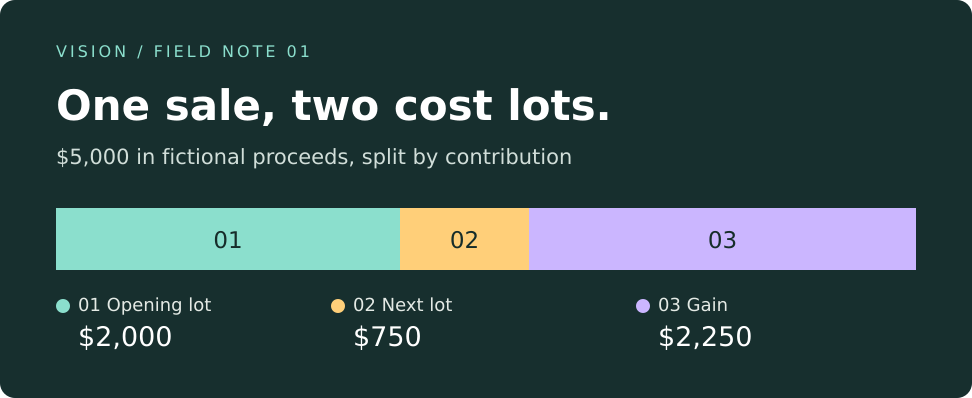
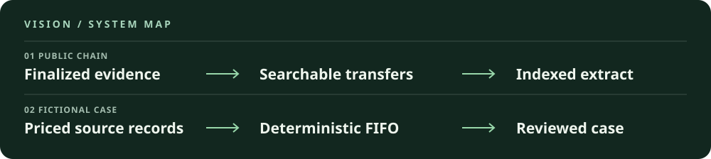

# Vision

**An evidence-first workbench for Ethereum.** Search an address or transaction, inspect the transfers behind a label, and export exactly what the local index saw. A separate fictional case shows how verified economic records can be reconciled without guessing who owns a wallet or how much tax they owe.

**v1.3.0 · Python ≥3.10 · SQLite · Single-user research workbench.** The bundled reports run offline with the Python standard library.

## Compare Balancer Vault replays

Which sources recovered the archived transfers, and what explains each difference? Open the [published replay comparison](https://eaudoon.github.io/Vision/) or start `python3 app.py` and open the [local dashboard](http://127.0.0.1:8765/replay/). Pick a block and source to inspect its rows, block hashes, receipt witnesses and filter coverage. Enable the labeled diagnostic examples to explore a disagreement or an incomplete observation.

The archive and constructed importer replay cover the same three Ethereum mainnet blocks. The public-source entries record the outcome of a dated, bounded read. The dashboard can be used offline with the bundled capture. Check the downloaded reviewer JSON from the repository root.

```sh
python3 replay_compare.py --verify vision-replay-review.json
```

For the release evidence and the public capture procedure, see the [v1.3 notes](docs/V1.3.md) and [operations guide](docs/OPERATIONS.md).

## v1.2 Balancer Vault snapshot

Does Vision recover the same ERC-20-shaped transfers as the archived receipts? Run `python3 app.py` and open the [local transfer review](http://127.0.0.1:8765/#transfer-review). Expand a block to inspect its archive evidence and importer rows. The scope is the Balancer Vault on Ethereum mainnet, with one finalized block per comparison. Amounts are raw integers.

| Block | Archive matches | Receipt evidence |
| --- | ---: | --- |
| 22,431,084 | 2 | Logs 138 and 139, WETH in and rETH out |
| 17,034,870 | 2 | Logs 405 and 406, WETH in and rETH out |
| 17,034,869 | 0 | All 93 archived receipts and 208 logs examined |

The report compares archived facts with Vision’s importer running on constructed JSON-RPC inputs. Download its JSON and check the displayed SHA-256 against the pinned evidence offline.

```sh
python3 transfer_review.py --verify vision-balancer-vault-review.json
```

For a fresh copy from the command line, run `python3 transfer_review.py > vision-balancer-vault-review.json`. The original report and JSON are also available in the [published v1.2 snapshot](https://eaudoon.github.io/Vision/v1.2/). The fixture provenance and release checks are documented in the [archive notes](fixtures/balancer-vault/README.md) and [verification record](docs/VERIFICATION.md).

## The illustrated report: one sale, two cost lots



A fictional sale brings in **$5,000**, but only **$2,250 is gain**: the oldest units sold cost $2,000, and the next half unit cost $750. Compare gain against its own declaration and income against its own; neither difference is a tax bill.

**Fastest:** [download the single-file illustrated report](https://github.com/EauDoon/Vision/raw/refs/heads/main/static/vision-field-note.html) and open it in a browser. The chart and styles are embedded.

**With the workbench:** download the [source ZIP](https://github.com/EauDoon/Vision/archive/refs/heads/main.zip), extract it, and open `static/report.html` in a browser, keeping its sibling CSS and SVG files alongside it. No install, server or network is needed. From the running app, choose **Read the fictional case**. Use your browser’s Print / Save as PDF to keep a copy. [Read the worked example and reproduction steps on GitHub](docs/FIELD-NOTE.md).

## Try it in two minutes

From the folder containing `app.py`:

```bash
python3 app.py
```

On Windows, use `py -3 app.py`. Open **http://127.0.0.1:8765**. For a different local port or database, pass `--port` and `--db`. The default database is `./data/vision.sqlite3` relative to the working directory.

1. **Chain explorer → Open sample address.** The six records are fictional and marked **SYNTHETIC**. Select a transaction to open the underlying block, amount, contract and log index. Search also recognizes tx hashes, block hashes/heights, event IDs, asset identifiers and chain-qualified accounts.
2. **Label directory → search “USDC”.** This is a sourced public *contract reference*, not a statement about anybody who touched it. A correct label with no indexed transfers is a valid result.
3. **Reconciliation.** The fictional disposal has $5,000 of proceeds and $2,750 of matched FIFO basis: $2,250 of reconstructed gains against $2,000 declared. Income is $180 against $100 declared. Change the declared amounts in the unsaved what-if, inspect source lots, or save a review note on the baseline.
4. **Export.** Explorer exports the current bounded search and supporting crawl windows. Case export includes synthetic input, rule-pack version, source/price references, reviewed findings and SHA-256 checksums. A checksum detects changes; it is not a signature.

## Crawl actual blocks

Set `VISION_RPC_URL` in the **server environment** to a trusted Ethereum mainnet HTTPS JSON-RPC endpoint that provides finalized blocks, full transactions, receipts and logs, then restart. No URL comes from a browser request. PublicNode publishes [its official endpoint here](https://ethereum.publicnode.com/); third-party provider availability and limits vary.

```bash
VISION_RPC_URL=https://ethereum-rpc.publicnode.com python3 app.py
```

PowerShell:

```powershell
$env:VISION_RPC_URL = "https://ethereum-rpc.publicnode.com"
py -3 app.py
```

Enter a public address, select a block count and optionally an end height. The dashboard supports 1–8 finalized blocks per request (selected presets or API); the [backfill CLI](docs/OPERATIONS.md) covers longer user-selected historical ranges in resumable batches. The RPC provider sees address filters. Use a provider appropriate for your research, respect quotas, and keep credentials out of source and logs. For other trusted HTTPS providers, set `VISION_RPC_ALLOWED_HOSTS` to their exact comma-separated hostnames. Do not accept untrusted hostnames.

**Read the result literally.** Vision indexes successful nonzero top-level ETH transfers with an explicit recipient, plus ERC-20-shaped Transfer logs where the queried address is sender or recipient. Querying a **token contract address** does not retrieve every transfer emitted by that contract. Unknown decimals stay raw. Finality is the provider’s assertion. Empty results apply only to the selected blocks and supported event types. There is no native-internal tracing, NFT or DeFi classification, automatic pricing, or cross-chain indexing.

## How it fits together



The paths deliberately **do not join**. A transfer is not automatically a sale, common ownership, income, evasion, or a tax liability. The FIFO component checks period boundaries, exact quantities, price provenance and available basis. Missing evidence blocks the result rather than silently estimating it. Its versioned demonstration pack has **no jurisdiction**. No LLM or private taxpayer data is needed.

- [Research, scope and 30/60/90-day plan](docs/PLAN.md): opportunity, what the sources support, what is missing, golden-set design, governance and pilot gates.
- [Operations and API](docs/OPERATIONS.md): configuration, local data boundaries, API contract, checksums, targeted historical ingestion and release checks.
- [Optional frontend checks](docs/UI-TESTS.md): reproducible desktop/mobile workflows.

## Verify

```bash
python3 -m unittest discover -s tests -v
python3 report.py --check     # refuses stale or incomplete generated report assets
node --check static/app.js
```

The core tests run without internet: they cover RPC fixtures including reverts and self-transfers, deduplication, decimal precision, blocked calculations when inputs are missing, HTTP validation, database persistence and export integrity. A provider-backed end-to-end run is a **separate** check. See [verification notes](docs/VERIFICATION.md) for the exact release evidence and limitations.

**Local only.** Do not reverse-proxy the built-in server or run this with real taxpayer, KYC, private account or case data. Production would require a lawful data gateway, country-specific counsel-approved packs, authenticated case-level access, protected immutable audit custody, retention/correction policies and an independent security review.
