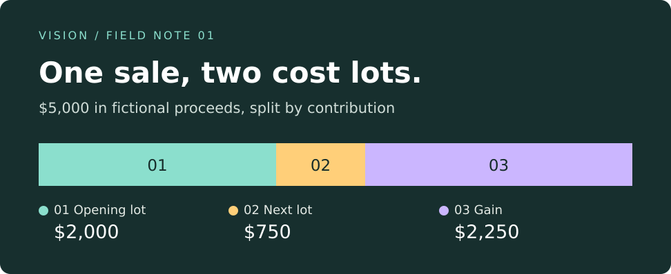

# Field note 01: one sale, two cost lots

**Question.** A fictional sale produces $5,000. How much is gain, and how does that compare to the declaration? The public-chain index is not an input.

| FIFO match (fictional USD) | Units used | Unit cost | Matched cost |
|---|---:|---:|---:|
| 1 Dec 2025 opening lot | 2 | $1,000 | $2,000 |
| 1 Feb 2026 purchase | 0.5 | $1,500 | $750 |
| **Total** | **2.5** | | **$2,750** |

In the 2026 example the sale used the opening lot first; only half of the next unit was needed. $5,000 of proceeds minus $2,750 of matched cost gives $2,250 of realized gain. Against a fictional $2,000 declaration, the **gain difference is $250**. A separate reward contributes $180 of reconstructed income against $100 declared: **income difference $80**. Neither is a liability or a finding of misconduct.

**Run it.** Open `static/report.html` locally with its sibling CSS and SVG files, or follow the illustrated-report link in the running workbench. Expand the fixture-source disclosure to inspect the acquisition and price references. For a different declaration, use the app's Reconciliation → What-if; this static report always depicts the frozen example.

**Reproduce it.** From the repository root run `python3 report.py --check` (read-only drift check), or rebuild with `python3 report.py`. Only the synthetic fixture and deterministic reconciliation feed the generated chart/HTML. There is no database, RPC, review text, analytics, CDN, web font, or live data lookup in that path.
